  Software engineer at Citi in Dublin. In the evenings I build terminal tools, mostly for readers and for people running coding agents.
    
  <a href="https://kameleon21.github.io/Personal-Website/">Website</a> •
  <a href="https://x.com/KamilRogozinski">X</a> •
  <a href="https://www.linkedin.com/in/kamil-rogozinski/">LinkedIn</a>

### 🗂 What I'm building

<pre>
<b>kamil@dublin</b> ~ $ ls -l ~/projects
drwxr-xr-x  <a href="https://github.com/Kameleon21/oku">oku/</a>          go     Hardcover books in a lazygit-style TUI
drwxr-xr-x  <a href="https://github.com/Kameleon21/tokenlens">tokenlens/</a>    go     what your coding agents really cost
drwxr-xr-x  <a href="https://github.com/Kameleon21/tmux-claude-session-manager">tmux-claude/</a>  shell  many Claude Code sessions, one popup
drwxr-xr-x  <a href="https://github.com/Kameleon21/bide">bide/</a>         go     a game that says when Claude needs you
</pre>

  
   
  <code>brew install --cask kameleon21/oku/oku</code>

### 📖 On the nightstand

<!-- oku:start -->
_Between books right now. Recommendations welcome._
<!-- oku:end -->

Synced from Hardcover every morning by <a href="https://github.com/Kameleon21/oku">oku</a>.

### 🦎 Steal these for your profile

<table>
  <tr>
    <td width="33%" valign="top">
      <b><a href="https://github.com/Kameleon21/gh-kameleon">gh-kameleon</a></b> A chameleon eats your contribution graph and turns the colour of what it ate.
    </td>
    <td width="33%" valign="top">
      <b><a href="https://github.com/Kameleon21/gh-terminal-fetch">gh-terminal-fetch</a></b> Your profile as a neofetch panel, typed out live in a tmux window.
    </td>
    <td width="33%" valign="top">
      <b><a href="https://github.com/Kameleon21/gh-snake-contributions">gh-snake-contributions</a></b> Your year of commits, played as a game of Snake.
    </td>
  </tr>
  <tr>
    <td width="33%" valign="top">
      
    </td>
    <td width="33%" valign="top">
      
    </td>
    <td width="33%" valign="top">
      
    </td>
  </tr>
</table>

Each one is a single GitHub Action with a daily cron. Add it to your <code>USERNAME/USERNAME</code> repo and it keeps itself fresh.

